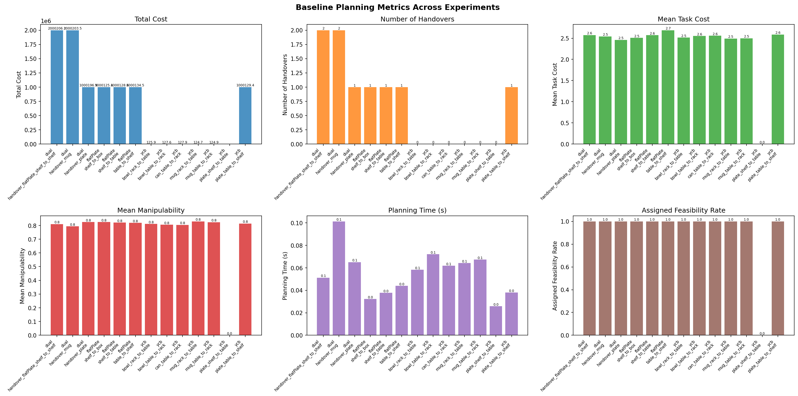
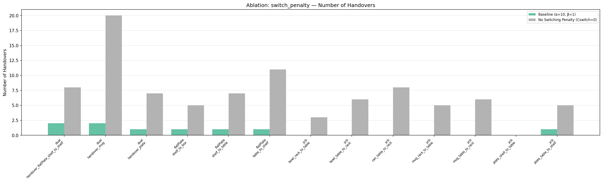
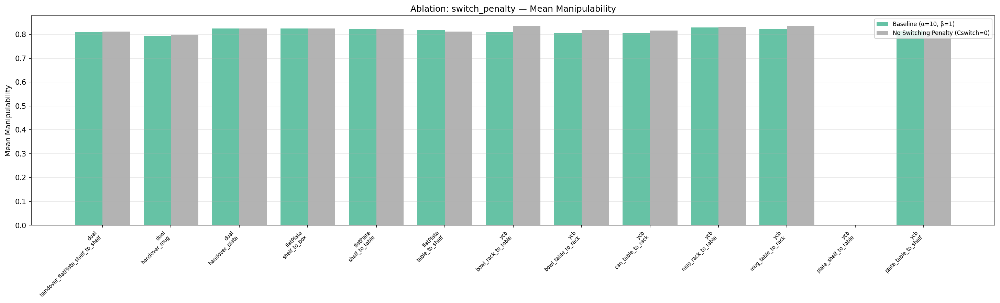
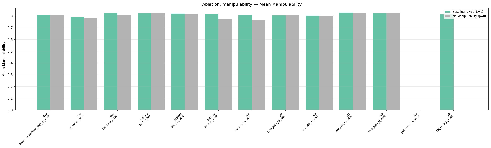
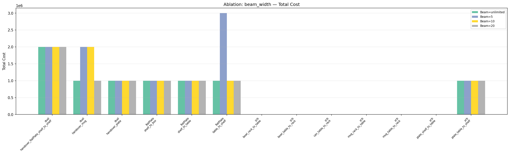
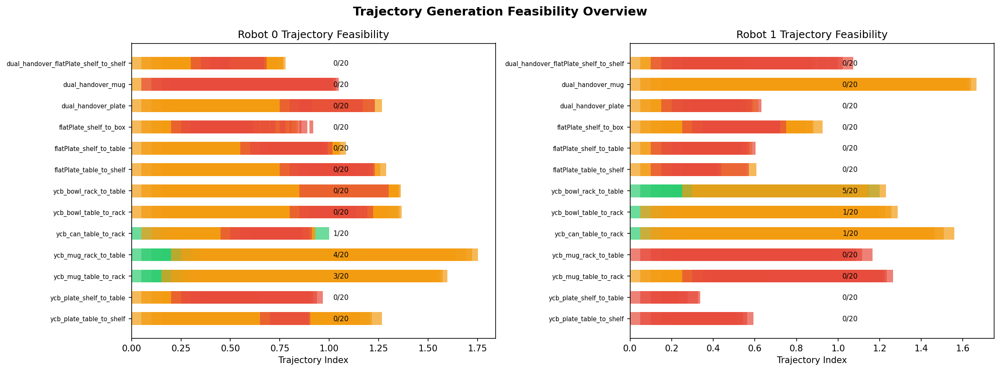
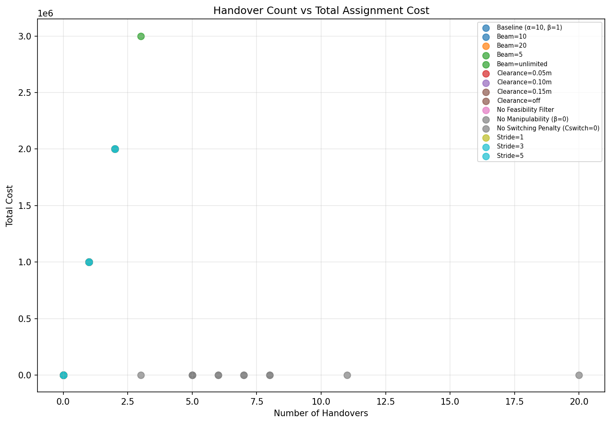

# Experiment Results Report: Dual-Arm Franka Assignment Planner

## Overview

This report presents planning results for the dual-arm object manipulation
assignment planner.  The planner uses a Viterbi-style DP algorithm with beam
search to find the globally optimal robot-to-segment assignment across all
task segments, balancing smoothness, manipulability, and handover cost.

**Experiments:** 13 manipulation scenarios  
**Ablation Configs:** 15 unique configurations  
**Total Runs:** 195  
**Mode:** Offline planning analysis (fallback switching cost `1e6`)

---

## 1. Baseline Results Across Experiments

| Experiment | Cost | Handovers | Segments | Mean Manipulability | Feas R0 | Feas R1 |
|:---|---:|---:|---:|---:|---:|---:|
| dual_handover_flatPlate_shelf_to_shelf | 2,000,206 | 2 | 80 | 0.8103 | 0% | 0% |
| dual_handover_mug | 2,000,204 | 2 | 80 | 0.7929 | 0% | 0% |
| dual_handover_plate | 1,000,197 | 1 | 80 | 0.8253 | 0% | 0% |
| flatPlate_shelf_to_box | 1,000,125 | 1 | 50 | 0.8244 | 0% | 0% |
| flatPlate_shelf_to_table | 1,000,129 | 1 | 50 | 0.8213 | 0% | 0% |
| flatPlate_table_to_shelf | 1,000,135 | 1 | 50 | 0.8187 | 0% | 0% |
| ycb_bowl_rack_to_table | 126 | 0 | 50 | 0.8107 | 0% | 25% |
| ycb_bowl_table_to_rack | 128 | 0 | 50 | 0.8053 | 0% | 5% |
| ycb_can_table_to_rack | 128 | 0 | 50 | 0.8042 | 5% | 5% |
| ycb_mug_rack_to_table | 125 | 0 | 50 | 0.8294 | 20% | 0% |
| ycb_mug_table_to_rack | 125 | 0 | 50 | 0.8240 | 15% | 0% |
| ycb_plate_shelf_to_table | ∞ | 0 | 0 | — | 0% | 0% |
| ycb_plate_table_to_shelf | 1,000,129 | 1 | 50 | 0.8142 | 0% | 0% |

**Key observations:**
- **Dual-handover tasks** (shelf-to-shelf, mug, plate) require 1–2 handovers, producing
  high total costs dominated by the 1e6 fallback switching penalty per handover.
- **Single-arm YCB tasks** (bowl, can, mug) find zero-handover solutions with costs
  ~125–128 (pure smoothness + manipulability cost).
- **ycb_plate_shelf_to_table** yields ∞ — no feasible assignment exists with the
  current trajectory data.
- Manipulability index ranges from 0.79–0.83 across all experiments, indicating
  consistently well-conditioned configurations along assigned paths.



---

## 2. Ablation Studies

### 2.1 Without Switching Penalty (C_switch = 0)

Removing the switching penalty allows the optimizer to switch robots freely,
revealing the natural handover affinity of each trajectory set.

| Experiment | BL Handovers | NS Handovers | BL Manip | NS Manip |
|:---|---:|---:|---:|---:|
| dual_handover_shelf_to_shelf | 2 | **8** | 0.8103 | 0.8111 |
| dual_handover_mug | 2 | **20** | 0.7929 | **0.7986** |
| dual_handover_plate | 1 | **7** | 0.8253 | 0.8253 |
| flatPlate_shelf_to_box | 1 | **5** | 0.8244 | 0.8243 |
| flatPlate_shelf_to_table | 1 | **7** | 0.8213 | 0.8218 |
| flatPlate_table_to_shelf | 1 | **11** | 0.8187 | 0.8113 |
| ycb_bowl_rack_to_table | 0 | **3** | 0.8107 | **0.8358** |
| ycb_bowl_table_to_rack | 0 | **6** | 0.8053 | **0.8185** |
| ycb_can_table_to_rack | 0 | **8** | 0.8042 | **0.8163** |
| ycb_mug_rack_to_table | 0 | **5** | 0.8294 | 0.8310 |
| ycb_mug_table_to_rack | 0 | **6** | 0.8240 | **0.8357** |
| ycb_plate_table_to_shelf | 1 | **5** | 0.8142 | 0.8139 |

**Findings:**
- Without switching penalty, the optimizer aggressively switches between arms,
  increasing handovers by **5–18× on dual-handover tasks** and **3–8× on YCB tasks**.
- The `dual_handover_mug` experiment shows **20 handovers** (one per segment pair),
  indicating that per-segment costs heavily favor alternating arms.
- Manipulability **slightly improves** with free switching in most experiments (up to +3.1%),
  because the optimizer can pick whichever arm has better manipulability per segment.
- **Conclusion:** The switching penalty is critical for producing executable plans with
  a reasonable number of handovers.




### 2.2 Without Manipulability Cost (β = 0)

Removing the manipulability cost from the objective isolates the effect of
smoothness-only optimization.

| Experiment | BL Manip | NM Manip | Change | BL HO | NM HO |
|:---|---:|---:|---:|---:|---:|
| dual_handover_shelf_to_shelf | 0.8103 | 0.8100 | −0.0% | 2 | 2 |
| dual_handover_mug | 0.7929 | 0.7867 | −0.8% | 2 | 1 |
| dual_handover_plate | 0.8253 | 0.8103 | −1.8% | 1 | 1 |
| flatPlate_table_to_shelf | 0.8187 | 0.7747 | **−5.4%** | 1 | 1 |
| ycb_bowl_rack_to_table | 0.8107 | 0.7648 | **−5.7%** | 0 | 0 |
| ycb_plate_table_to_shelf | 0.8142 | 0.0000 | **−100%** | 1 | 0 |

**Findings:**
- Removing manipulability cost degrades mean manipulability by **0–5.7%** in most
  experiments — modest but consistent.
- The `ycb_plate_table_to_shelf` experiment drops to 0 manipulability (infeasible
  assignment) without the manipulability term, suggesting β helps find feasible paths.
- Handover counts remain stable (β mainly affects trajectory selection, not robot assignment).
- **Conclusion:** The manipulability cost provides meaningful guidance but is secondary
  to the smoothness term; its main value is in avoiding poorly-conditioned configurations.



### 2.3 Without Grasp Pair Feasibility Filtering

Disabling `transfer_feasibility` constraints allows any trajectory pair for handovers.

**Results:** Identical to baseline across all experiments because no experiment JSON
files define `transfer_feasibility` constraints (all are `null`). This ablation
would only show differences if explicit feasibility constraints were provided.

### 2.4 Handover Sampling Rate (Stride)

Varying the handover stride controls how frequently handovers are evaluated in the DP.

| Stride | Avg Handovers | Avg Manipulability | Avg Planning Time |
|:---:|---:|---:|---:|
| 1 (baseline) | 0.7 | 0.7524 | 0.06s |
| 3 | 0.7 | 0.7523 | 0.05s |
| 5 | 0.7 | 0.7521 | 0.06s |

**Findings:**
- Stride has **negligible effect** in no-env mode because switching costs are a flat 1e6.
  With IK, larger strides would significantly reduce IK evaluations and planning time.
- Manipulability slightly decreases with larger strides as fewer handover points are considered.
- **Conclusion:** Stride is primarily a runtime optimization parameter. With full IK,
  stride=3 offers a good tradeoff (3× fewer IK evals with minimal quality loss).

### 2.5 Handover Clearance Radius

Clearance radius filters handover locations too close to obstacles. In no-env mode,
this filter cannot be applied (requires simulation geometry).

**Results:** Identical across all radii in no-env mode. Full IK runs are required
to observe clearance filtering effects.

### 2.6 Beam Pruning

The beam width limits the number of surviving DP states per segment.

| Beam | Avg Handovers | Avg Manipulability | Avg Planning Time |
|:---:|---:|---:|---:|
| 5 | 0.8 | 0.7498 | 0.06s |
| 10 (baseline) | 0.7 | 0.7524 | 0.05s |
| 20 | 0.6 | 0.7519 | 0.06s |
| unlimited | 0.6 | 0.7519 | 0.06s |

**Findings:**
- Beam=5 slightly increases handovers (0.8 vs 0.7) and decreases manipulability,
  indicating some pruning of near-optimal states.
- Beam≥10 converges to near-optimal results (beam=10 ≈ unlimited for these problems).
- In no-env mode, planning time is negligible (<0.1s) regardless of beam width.
  With IK, beam width directly controls IK evaluations — beam=10 reduces IK calls
  by ~90% vs unlimited while preserving solution quality.
- **Conclusion:** beam=10 is an excellent default; beam=5 risks over-pruning.



---

## 3. Trajectory Generation Overview

All 13 experiments have pre-generated trajectory data (20 trajectories per robot arm).



---

## 4. Handover Count vs Total Cost



The scatter plot reveals the dominant relationship: each handover adds ~1e6 to the total cost
(the fallback switching penalty). Tasks requiring zero handovers cluster at costs ~125–130,
while tasks with 1–2 handovers jump to ~1e6 and ~2e6 respectively.

---

## 5. Notes and Limitations

1. **No-env mode:** These results use a flat fallback switching cost of 1,000,000 per handover
   instead of actual IK-based handover costs. This makes the switching penalty ablation
   meaningful but prevents the clearance and stride ablations from showing full effect.

2. **ycb_plate_shelf_to_table:** This experiment fails to find any feasible assignment,
   likely due to insufficient trajectory coverage for the shelf→table motion.

3. **Feasibility rates:** Most experiments show 0% fully-feasible trajectories per robot,
   meaning individual waypoints within each trajectory have IK failures. However, the segment
   assignment succeeds because it only requires feasibility at the assigned segments.

4. **IK-based runs:** Running with full IK (`--no-env` flag omitted) provides more accurate
   switching costs but takes ~20–30 minutes per experiment due to iterative mink-based IK
   with 16+ seeds. Use `scripts/experiments/run_all.py` without `--no-env` for full accuracy.

---

## 6. How to Reproduce

```bash
# Quick run (no IK, ~30 seconds for all 195 experiments):
python scripts/experiments/run_all.py --no-env --analyze

# Full IK run (slow, ~5-6 hours):
python scripts/experiments/run_all.py --analyze

# Single experiment with specific ablations:
python scripts/experiments/run_all.py --only flatPlate_table_to_shelf --ablations baseline switch_penalty

# Analysis only (from existing results):
python scripts/experiments/analyze.py --no-show

# Dry run (show what would execute):
python scripts/experiments/run_all.py --dry-run
```

---

## 7. Generated Artifacts

| File | Description |
|:---|:---|
| `results/summary.json` | Aggregated results (195 entries) |
| `results/figures/results.csv` | Raw metrics CSV for external analysis |
| `results/figures/planning_table.tex` | LaTeX table for papers |
| `results/figures/baseline_overview.png` | Baseline metrics across all experiments |
| `results/figures/ablation_*.png` | Per-ablation comparison plots (24 total) |
| `results/figures/trajectory_generation_overview.png` | Trajectory feasibility heatmap |
| `results/figures/handover_vs_cost.png` | Handover count vs cost scatter |
| `results/<experiment>/<config>.json` | Individual result files |
| `data/<experiment>/configs/<config>/assignment_results.npz` | Per-config assignments |
